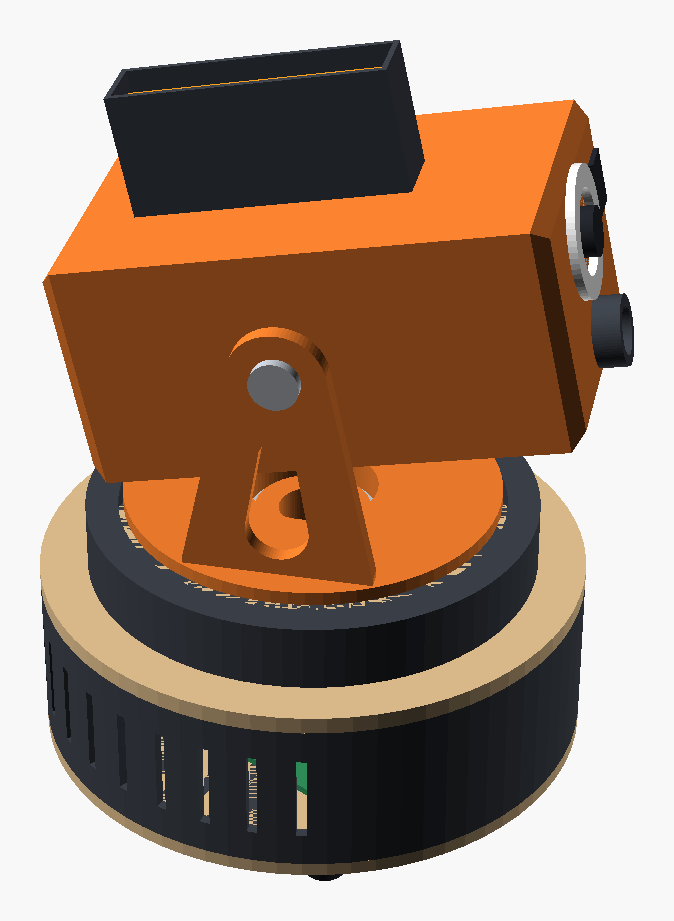
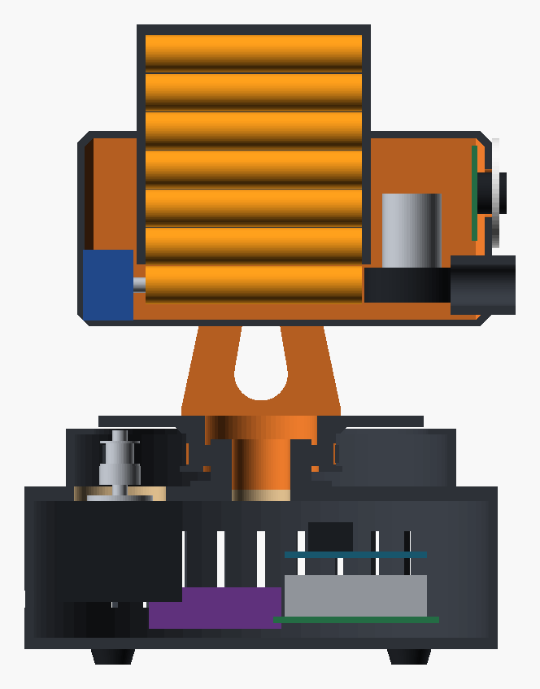
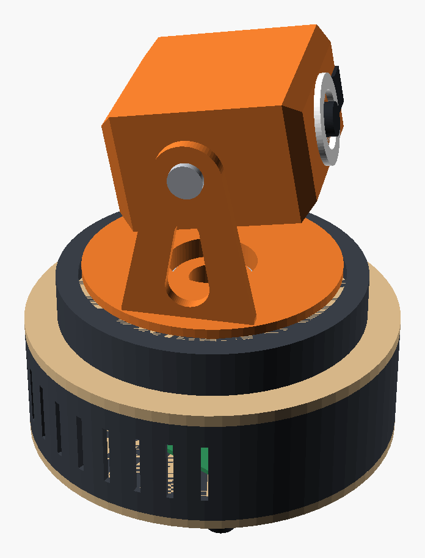
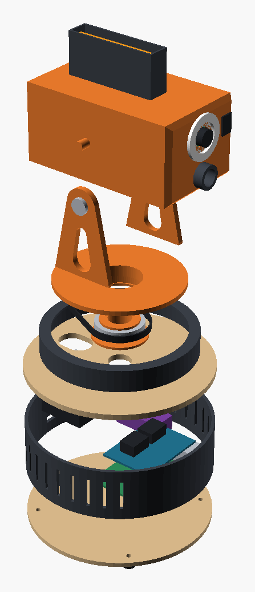
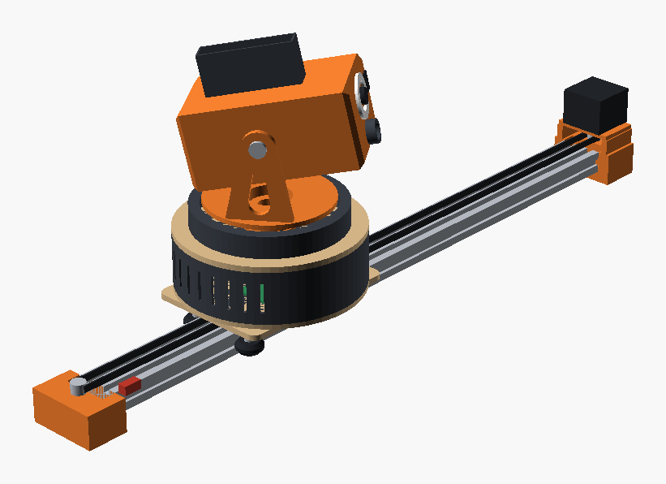

# Strix

A desktop sentry robot that sits still and turns its head, like the owl it is
named after. About 22 cm tall, with a pan/tilt turret head, a swappable payload
(camera, sensors, foam-dart launcher) and a base that is ready to ride a rail.



> **Status: concept model v0.1.** It proves that everything fits and where each
> part sits. These are not print-ready parts yet: fasteners, fit tolerances and
> cable routing are missing, and the launcher is untested.

## Specs

| | |
|---|---|
| Height | 216 mm with launcher, ~170 mm with the sensor head |
| Base | Ø 160 mm |
| Pan | ±170°, NEMA17 + GT2 belt, 4:1 reduction |
| Tilt | −15° … +35°, MG90S servo |
| Rail (optional) | 2040 V-slot extrusion, 600 mm → ~400 mm of travel |

## Architecture

- **Base (fixed):** pan motor, electronics and power. Flat plates for laser cutting.
- **Turntable:** an 80-tooth pulley printed as one part, riding on a 6806 bearing
  over a hollow spigot that lets the cables through (Ø 20 mm bore).
- **Cradle:** the head itself. It tilts between two arms and is a swappable module.
- **Rail:** a separate module. The robot bolts to the carriage through the four
  M4 holes (100 mm square) that otherwise hold its rubber feet.



The stepper motors from an Ender 3 (NEMA17 42-34 with a 20-tooth pulley) work
as they are for both the pan drive and the rail; the model is sized around them.

## Phases

1. Base, pan and tilt with the sensor head.
2. Launcher head.
3. Rail.

| Sensor head | Exploded view | On the rail |
|---|---|---|
|  |  |  |

## Model

`cad/strix-v0.1.scad` is parametric ([OpenSCAD](https://openscad.org/)). The view
switches are at the top of the file:

```bash
# assembled view
openscad cad/strix-v0.1.scad -o out/hero.png

# sensor head, exploded view, section and rail
openscad cad/strix-v0.1.scad -o out/sensor.png  -D show_launcher=false
openscad cad/strix-v0.1.scad -o out/explode.png -D explode=1
openscad cad/strix-v0.1.scad -o out/cut.png     -D cutaway=true -D pan=0 -D tilt=0
openscad cad/strix-v0.1.scad -o out/rail.png    -D show_rail=true
```

Model colours: orange and dark grey = 3D printed, wood = laser cut,
silver and black = off the shelf, green = electronics.

## To do

- Turn phase 1 into printable parts (screws, inserts, clearances).
- Measure the pan centre distance (46.0 mm calculated) with the real belt.
- Verify the V-wheel spacing across the extrusion (59.7 mm).
- Tune the launcher: flywheel gap, pusher and magazine.
