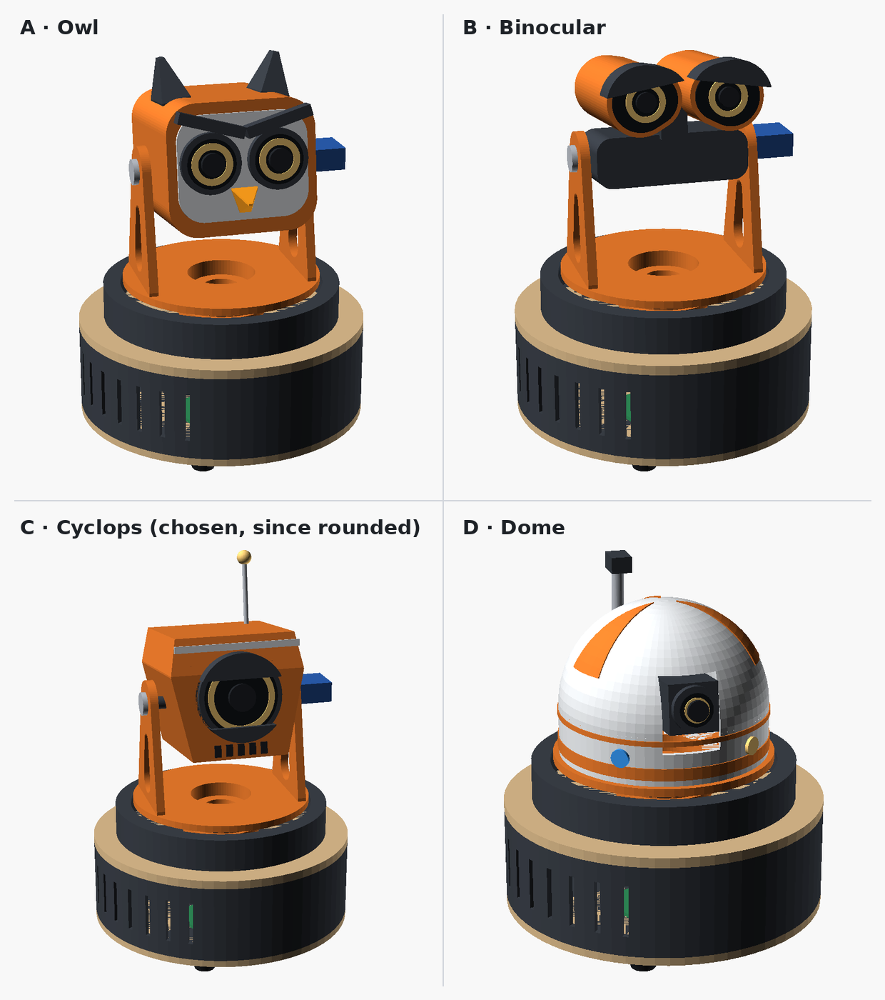

# Strix

A desktop sentry robot that sits still and turns its head, like the owl it is
named after. About 19 cm tall, with a one-eyed pan/tilt turret head, a swappable
payload (camera, sensors, foam-dart launcher) and a base that is ready to ride a rail.


> **Status: concept model v0.1.** It proves that everything fits and where each
> part sits. These are not print-ready parts yet: fasteners, fit tolerances and
> cable routing are missing, and the launcher is untested.

## Specs

| | |
|---|---|
| Height | 187 mm to the top of the head, 234 mm to the antenna tip (216 mm to the magazine with the launcher) |
| Base | Ø 160 mm |
| Pan | ±170°, NEMA17 + GT2 belt, 4:1 reduction |
| Tilt | −15° … +35°, MG90S servo |
| Rail (optional) | 2040 V-slot extrusion, 600 mm → ~400 mm of travel |

## Architecture

- **Base (fixed):** pan motor, electronics and power. Flat plates for laser cutting.
- **Turntable:** an 80-tooth pulley printed as one part, riding on a 6806 bearing
  over a hollow spigot that lets the cables through (Ø 20 mm bore).
- **Head:** a cyclops. A rounded pod with a single eye on a short barrel: a camera for
  a pupil, a glowing iris and two shutters that blink and squint. It tilts between two
  arms and is a swappable module.
- **Rail:** a separate module. The robot bolts to the carriage through the four
  M4 holes (100 mm square) that otherwise hold its rubber feet.


## Electronics

| Part | Where | Job |
|---|---|---|
| Raspberry Pi Zero 2 | Head | Brain: vision and behaviour |
| Raspberry Pi camera (CSI) | Head, behind the pupil | Vision. The ribbon stays short and never crosses a rotating joint |
| Raspberry Pi Pico | Base | Step generation for both steppers, servos, sensors, LEDs |
| 2 × stepper driver (TMC2209 or A4988) | Base | Pan and rail motors |
| 12–24 V supply + 5 V buck (~3 A) | Base | Motors on the high rail; Pi, Pico and servos on 5 V |

Only 5 V power and a serial link run up through the hollow pan axis.

The stepper motors from an Ender 3 (NEMA17 42-34 with a 20-tooth pulley) work
as they are for both the pan drive and the rail; the model is sized around them.

## Phases

1. Base, pan and tilt with the sensor head (the default view above).
2. Launcher head: the same face on a longer pod, with a flatter belly for the flywheels,
   the muzzle under the eye and a magazine on top.
3. Rail.

| Launcher head | Exploded view | On the rail |
|---|---|---|
|  |  |  |

### Head studies

Four heads were sketched on the same base before settling on the cyclops, which
was then rounded into the pod above. The others are still in the model (`head_style`).



## Model

`cad/strix-v0.1.scad` is parametric ([OpenSCAD](https://openscad.org/)). The view
switches are at the top of the file:

```bash
# assembled view (sensor head)
openscad cad/strix-v0.1.scad -o out/hero.png

# launcher head, exploded view, section and rail
openscad cad/strix-v0.1.scad -o out/launcher.png -D show_launcher=true
openscad cad/strix-v0.1.scad -o out/explode.png  -D show_launcher=true -D explode=1
openscad cad/strix-v0.1.scad -o out/cut.png      -D show_launcher=true -D cutaway=true -D pan=0 -D tilt=0
openscad cad/strix-v0.1.scad -o out/rail.png     -D show_rail=true

# another head study
openscad cad/strix-v0.1.scad -o out/owl.png -D 'head_style="owl"'
```

Model colours: orange and dark grey = 3D printed, wood = laser cut,
silver and black = off the shelf, green = electronics.

## To do

- Turn phase 1 into printable parts (screws, inserts, clearances).
- Measure the pan centre distance (46.0 mm calculated) with the real belt.
- Verify the V-wheel spacing across the extrusion (59.7 mm).
- Tune the launcher: flywheel gap, pusher and magazine.
- Design the eye shutter mechanism (one micro servo) and the iris lighting.
