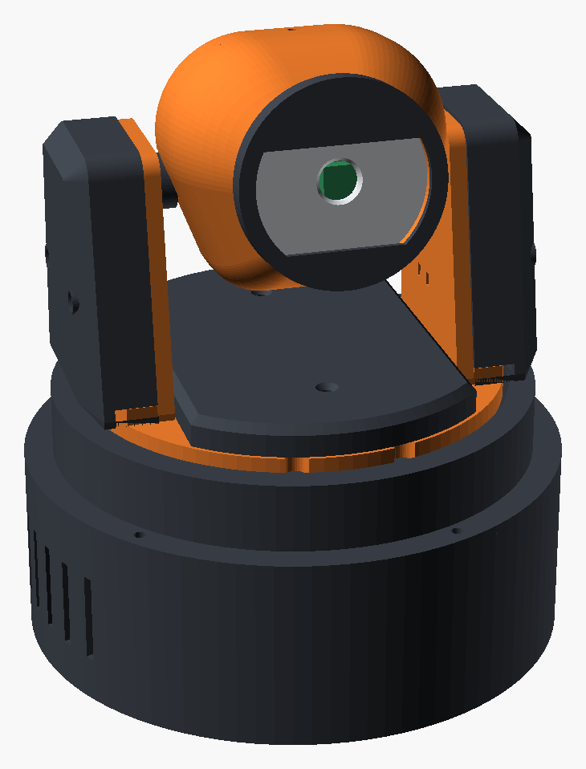
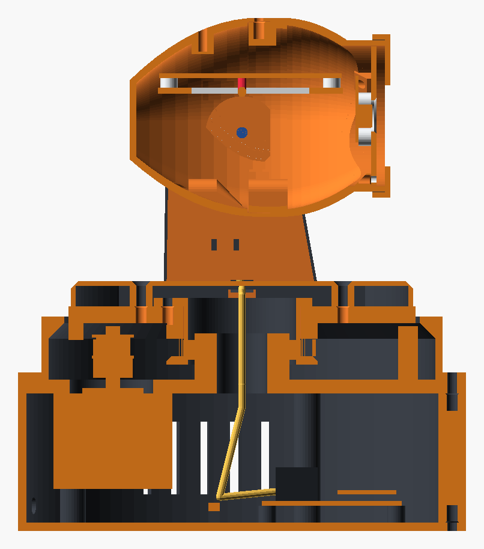
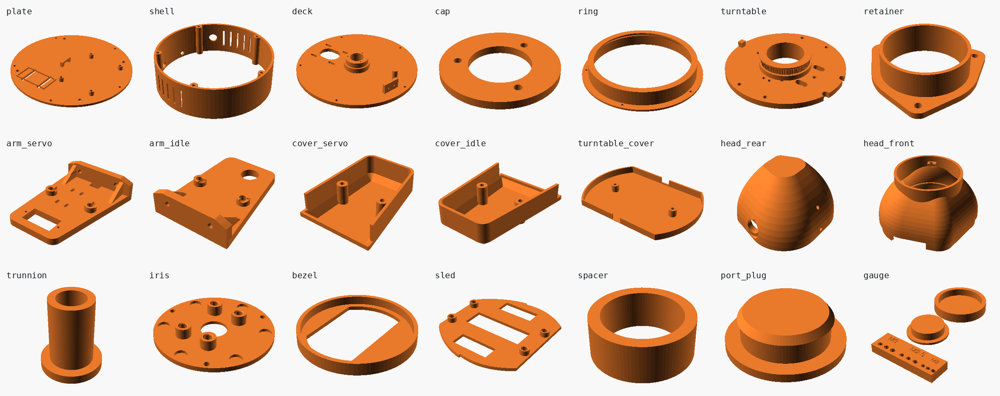
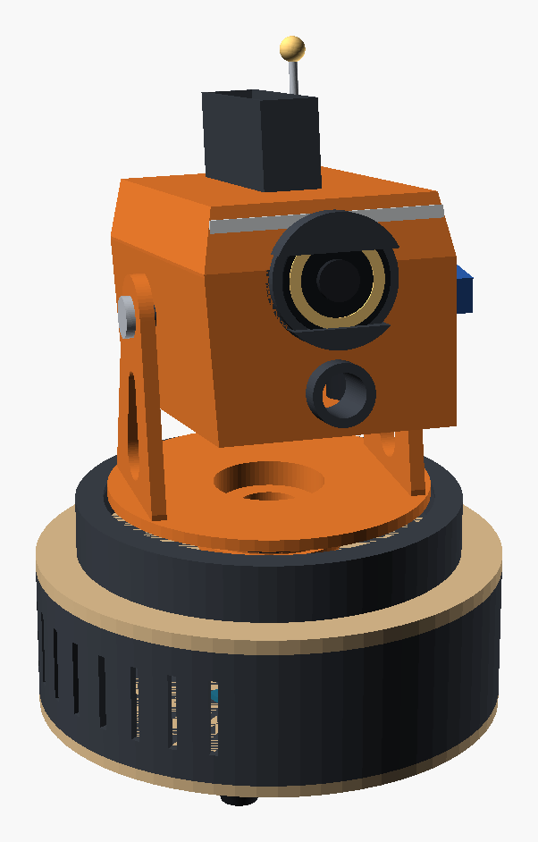

# Strix

A desktop sentry robot that sits still and turns its head, like the owl it is
named after. About 19 cm tall, with a one-eyed pan/tilt turret head, a swappable
payload (camera, sensors, foam-dart launcher) and a base that is ready to ride a rail.



> **Status.** Phase 1 (base, pan stage, yoke and the sensor head) exists as
> printable parts with STLs. **Nothing has been printed yet**, so treat every fit
> as a first guess and start with the `gauge` part. The launcher head and the rail
> are still concept models.

## Specs

| | |
|---|---|
| Height | 188 mm to the top of the head, plus the antenna |
| Base | Ø 160 mm |
| Pan | ±165° between a hard stop, NEMA17 + GT2 belt, 4:1 reduction |
| Tilt | −15° … +35°, MG90S servo |
| Brain | Raspberry Pi Zero 2 and Pi camera in the head, Raspberry Pi Pico in the base |
| Rail (planned) | 2040 V-slot extrusion, 600 mm → ~400 mm of travel |

**The head does not spin forever.** The cables run up through the hollow pan axis,
so a lug under the turntable meets a post on the deck at about ±173°, and a
microswitch just before it gives the firmware its home position. The 18 mm bore
leaves room for a slip ring if continuous rotation is wanted later.

## How it goes together



- **Base (fixed):** bottom plate, shell and deck. Five M3 screws go through the
  belt cover and the deck into inserts in the shell; five more hold the plate.
- **Pan stage:** the deck carries a hollow spigot. A 6806 bearing sits on it and
  drops into the turntable, whose rim is an 80-tooth GT2 pulley. The NEMA17 hangs
  under the deck on slots, so sliding it tensions the belt.
- **Yoke:** two arms bolted to the turntable. One holds the tilt servo, the other a
  small bearing for the axle screw.
- **Head:** a rounded pod in two halves that print standing on their seam. One eye:
  the pupil is the camera, the iris is a ring of LEDs behind a thin printed skin.
  The Pi Zero 2 rides on a sled that slides into rails inside the rear half.

## Printing

`cad/strix-print.scad` holds every part; `stl/` has them exported in print pose.



| Part | Qty | Notes |
|---|---|---|
| `gauge` | 1 | **Print first.** Insert holes at −0.2 / nominal / +0.2 and the two bearing fits |
| `plate` | 1 | Standoffs for a 50 × 70 mm protoboard, rim and zip-tie slots for the buck converter |
| `shell` | 1 | Holes for a DC jack, a toggle switch and the future rail connector |
| `deck` | 1 | Flat side down. Carries the spigot, the stop post and the switch wall |
| `cap` | 1 | Retains the bearing's inner race |
| `ring` | 1 | Belt cover, flange down |
| `turntable` | 1 | Disc down, pulley up. Slow outer walls help the teeth |
| `retainer` | 1 | Flange down. Holds the outer race |
| `arm_servo`, `arm_idle` | 1 each | Flat, inner face down |
| `head_rear`, `head_front` | 1 each | Standing on the seam, no supports. Use a brim |
| `iris` | 1 | White or translucent filament, front face down |
| `bezel` | 1 | Dark filament, front face down |
| `sled` | 1 | Pi Zero 2 tray |
| `spacer` | 1 | Axle spacer |
| `port_plug` | 1 | Closes the rail connector hole for now |

Everything fits a 180 × 180 mm bed. PETG is the safer choice for the deck,
turntable and arms; PLA is fine for the rest.

Re-export after changing a parameter:

```bash
scripts/export-stl.sh              # all parts
scripts/export-stl.sh head_front   # just one
```

### Fits to tune

The fit parameters sit at the top of `cad/strix-print.scad`:

| Parameter | Default | What it is |
|---|---|---|
| `ins_m3`, `ins_m25`, `ins_m2` | 4.0, 3.6, 3.2 mm | Heat-set insert hole diameters. They differ between brands: check your insert's datasheet |
| `brg_post_fit`, `brg_bore_fit` | −0.05, +0.10 mm | Bearing on the spigot and in the turntable |
| `gt2_fit` | 0.05 mm | Opens the pulley tooth grooves |
| `tol` | 0.2 mm | General sliding clearance |

### Hardware

| Item | Qty | Where |
|---|---|---|
| M3 heat-set insert | 21 | Shell 10, turntable 7, head 4 |
| M2.5 heat-set insert | 4 | Pi Zero 2 sled |
| M2 heat-set insert | 11 | Protoboard 4, camera 4, iris plate 3 |
| M3 × 12 | 5 | Ring + deck into the shell |
| M3 × 8 | 8 | Plate into the shell 5, retainer 3 |
| M3 × 10 | 8 | Motor 4 (with washers), arms 4 |
| M3 × 20 | 2 | Head halves, driven from behind under the tail |
| M3 × 16 | 1 | Tilt axle |
| M3 × 6 | 1 | Head seam, top |
| M2.5 × 5 | 4 | Pi Zero 2 |
| M2 × 5 | 11 | Protoboard, camera, iris plate |
| M2 × 8 self-tapping | 3 | Spigot cap |
| M2 × 10 self-tapping | 2 | Homing switch |
| 6806-2RS bearing (30 × 42 × 7) | 1 | Pan |
| 623ZZ bearing (3 × 10 × 4) | 1 | Tilt axle |
| GT2 closed belt, 200 mm, 6 mm wide | 1 | Pan |
| GT2 20-tooth pulley, 5 mm bore | 1 | On the motor (Ender 3 X/Y motors already have one) |
| NEMA17 stepper, up to 34 mm long | 1 | Pan |
| MG90S servo | 1 | Tilt. Uses its own two screws and a straight two-arm horn |
| Lever microswitch (KW11 type) | 1 | Pan homing |
| 5 mm LED | 6 | Iris |
| 3 mm rod, about 60 mm | 1 | Antenna |
| Rubber feet, M4 or stick-on | 4 | Under the plate |

### Assembly order

1. Set the inserts. Fit the DC jack and switch to the shell, the protoboard and
   buck converter to the plate.
2. Hang the motor under the deck, screws loose. Screw the homing switch to its wall.
3. Press the bearing into the turntable and screw the retainer over it.
4. Loop the belt around the turntable pulley, lower the turntable onto the spigot
   and hook the belt over the motor pulley. Fit the cap.
5. Turn the turntable to 180°, reach the motor screws through its slots, tension
   the belt and tighten.
6. Drop the ring over the turntable and screw ring and deck to the shell.
7. Bolt both arms to the turntable.
8. Head: Pi on the sled, camera and LEDs on the iris plate, iris plate into the
   front half, bezel over the barrel. Slide the sled into the rear half, join the
   halves and fit the three seam screws.
9. Screw the servo horn into the recess on the head. Hold the head between the
   arms, push the servo through its arm into the horn and fit the axle screw with
   its spacer on the other side.

## Electronics

| Part | Where | Job |
|---|---|---|
| Raspberry Pi Zero 2 | Head | Brain: vision and behaviour |
| Raspberry Pi camera (CSI) | Head, behind the pupil | Vision. The ribbon stays short and never crosses a rotating joint |
| Raspberry Pi Pico | Base | Step generation for both steppers, servos, sensors, LEDs |
| 2 × stepper driver (TMC2209 or A4988) | Base | Pan and rail motors |
| 12–24 V supply + 5 V buck (~3 A) | Base | Motors on the high rail; Pi, Pico and servos on 5 V |

The stepper motors from an Ender 3 (NEMA17 42-34 with a 20-tooth pulley) work as
they are for both the pan drive and the rail.

## Dynamics

`sim/dynamics.py` integrates mass, centre of mass and inertia over the printable
meshes, adds the bought components as point masses and prints the margins:

```bash
python3 sim/dynamics.py
```

| | |
|---|---|
| Head | 122 g, centre of mass 10 mm ahead of the tilt axis |
| Rotating mass / whole robot | 251 g / about 0.9 kg |
| Pan inertia | 4.4 × 10⁻⁴ kg·m² including the reflected rotor |
| Pan acceleration available | about 105 000 °/s² (3 000 is plenty) |
| Tilt gravity torque, worst case | 14.6 mN·m against 180 mN·m of servo stall |
| 90° move / 330° unwind | 0.37 s / 1.04 s at 360 °/s and 3 000 °/s² |

The mechanics have a wide margin, so tracking quality is set by the vision loop
(frame rate and latency), not by the motor. The motor torque (0.2 N·m usable),
fill factors and component masses are assumptions listed at the top of the script.

## Known unknowns

These are assumptions built into the printable parts. Check each against the
part in your hand; all of them are parameters.

- **Motor pulley height.** The belt runs 11.4 mm above the deck. A press-fit
  pulley may sit elsewhere on the shaft; shim the motor if so.
- **Servo.** Body 22.8 × 12.2 mm, shaft 6 mm from the end, ear screws 27.8 mm apart.
- **Camera.** Lens assumed 1.2 mm off the centre of its four holes, towards the
  connector. The aperture is oversized to forgive about 1.5 mm.
- **Homing switch.** A KW11-style lever switch with holes 9.5 mm apart.
- **Protoboard.** 50 × 70 mm with holes 2 mm in from the edges.
- **Eye shutters.** The two lids are fixed for now; the blinking mechanism is not
  designed yet.

## Phases 2 and 3 (concept only)

`cad/strix-v0.1.scad` is the earlier layout model. It still carries the launcher
head and the rail, which have not been turned into printable parts.

| Launcher head | Exploded view | On the rail |
|---|---|---|
|  |  |  |

- **Launcher:** a flywheel launcher for standard foam darts (Ø 12.7 × 73 mm), with
  a gravity-fed magazine and a pusher servo. A flywheel cage salvaged from a toy
  blaster is a proven alternative to printing one.
- **Rail:** a carriage on V-wheels over a 2040 extrusion. The robot bolts on
  through the four M4 holes that otherwise hold its feet.

```bash
openscad cad/strix-v0.1.scad -o out/launcher.png -D show_launcher=true
openscad cad/strix-v0.1.scad -o out/rail.png     -D show_rail=true
```
